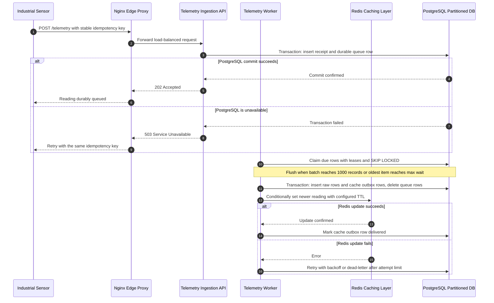

# System Architecture: IoT Telemetry Aggregator

## 1. Executive Summary (For Non-Technical Stakeholders & Product Teams)
Industrial IoT sensors (such as factory machines measuring temperature or vibration) fire off high-frequency data streams continuously. If thousands of sensors write directly to a standard database, the system will quickly choke and crash under the traffic weight. 

To solve this, our architecture acts as an intelligent pipeline:
* **The Edge Proxy (`Nginx`):** Acts as the smart front door, distributing incoming traffic across multiple server workers so no single application node is overwhelmed.
* **The Fast Cache (`Redis`):** Stores only the *latest* reading of each sensor in fast memory. When a dashboard loads, it grabs this current state instantly without querying the heavy database.
* **The Durable Queue & Partitioned Database (`PostgreSQL`):** Telemetry is acknowledged only after it is durably queued in PostgreSQL, then workers batch it into partitioned time-series tables.

---

## 2. High-Level Ingestion Flow

### Durable acceptance and retries

- The API validates each reading and writes its idempotency receipt and queue row in one PostgreSQL transaction. It returns `202 Accepted` only after commit; a transient database failure returns `503`, and the sender retries with the same key.
- Each key identifies one immutable reading. A repeated key with the same payload is treated as an already accepted request; reusing a key with a different payload is rejected with `409 Conflict`. Receipts remain after processing so retries cannot enqueue a reading twice. Retain them for at least the supported idempotency window.
- Workers claim eligible rows using leases and `FOR UPDATE SKIP LOCKED`, allowing concurrent workers and recovery of work from crashed workers after lease expiry. The worker must verify its lease token while processing so an expired claim cannot commit stale work. A worker stores the batch in `telemetry_raw`, adds cache outbox rows, and removes the claimed queue rows in one transaction. If any insert fails, the transaction rolls back and the queued readings remain available for retry. Split failing batches to isolate per-reading errors and prevent one bad reading from blocking other work.
- Flush a batch when it reaches 1000 readings or when the oldest queued reading reaches a configured maximum wait, whichever comes first.
- Retry transient PostgreSQL and Redis failures with exponential backoff and jitter. After a configured attempt limit, move the failed work to `telemetry_dead_letters` with its failure stage and last error; alert operators and support inspection and replay. Retries are at-least-once, with the idempotency receipt and transactional writes preventing duplicate acceptance.
- Redis is updated from the PostgreSQL outbox after the raw-data transaction commits. A Redis failure never rolls back stored telemetry. The Redis update must be idempotent and only replace a sensor's cached value when the incoming `recorded_at` is newer, so delayed retries cannot overwrite a more recent reading.
- Schedule partition maintenance and make its past window at least as long as the maximum expected queue delay. A missing partition is an operational error, not a transient outage; alert and create the needed partition before retry limits move affected readings to the dead-letter table.

## 3. Database Partitioning Strategy

# document the time-based table partitioning schema and index maintenance strategy here
A. Database Partitioning Strategy (PostgreSQL)
    
    * Partitioning Schema: We implement declarative range partitioning on the main telemetry table using the timestamp column, broken down into physical daily or weekly child tables (e.g.,telemetry_yymmdd).
    
    * Performance Impact:
        
        * Compact Indexes: B-tree indexes remain small and fit entirely within RAM memory, ensuring fast reads.
        
        * Partition Pruning: Queries specifying a time range automatically skip scanning irrelevant child tables, radically reducing query execution times for historical chart trends.
        
        * Retention & Archival: Old data can be dropped or archived instantly via DROP TABLE without causing expensive table-locking row deletions.

B. Caching Layer & Eviction Policy (Redis)
    
    * Purpose: Serves real-time client dashboard requests with sub-millisecond latency for live tracking widgets.
    
    * Eviction Policy: `allkeys-lru` evicts least-recently-used keys when memory is constrained; it does not specifically identify stale sensor readings. Configure a TTL if cached readings should expire. Redis is a disposable latest-value cache; PostgreSQL remains the durable source of truth.

## 4. Edge Proxy and Caching Interaction
A. Edge Proxy (Nginx) Interaction Model: Industrial sensors emit data at extremely high frequencies. Pushing this traffic directly to a single application instance creates a severe network bottleneck. Nginx acts as a reverse proxy and load balancer, terminating incoming SSL/TLS connections, buffering high-rate bursts and disturbing requests evenly across backend worker instances. this decouples the edge network from application logic and prevents upstream server overload.

B. Caching layer (Redis) Interaction Model: For real-time dashboards, querying historical time-series tables in PostgreSQL for current sensor states is computationally expensive and introduces unacceptable latency. A worker updates a fast in-memory key-value record in Redis from the PostgreSQL outbox after the raw reading commits. Conditional timestamp checks prevent out-of-order retries from replacing newer state. This isolates read-heavy dashboard polling from write-heavy telemetry pipelines while keeping PostgreSQL as the durable source of truth.